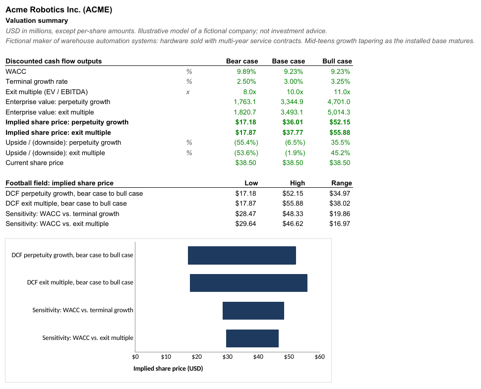
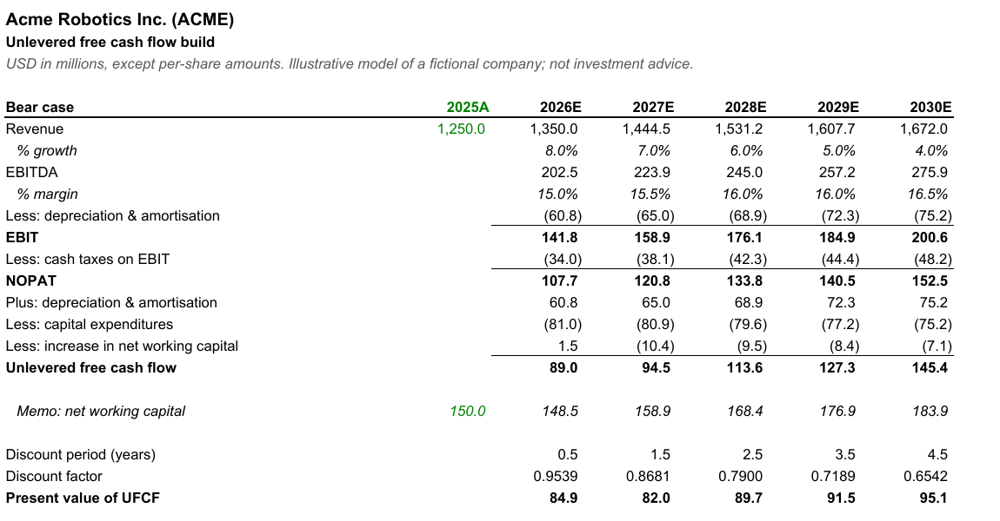
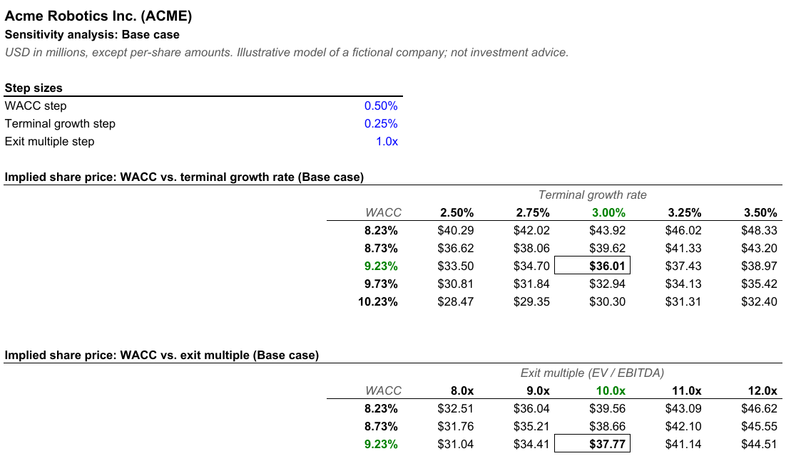

# dcf-engine

A discounted cash flow valuation engine in Python. You describe a company in a short YAML
file; it projects unlevered free cash flow, builds WACC from CAPM, values the business with
both a perpetuity growth and an exit multiple terminal value, and writes an Excel model in
which every number outside the input sheet is a live formula.

The workbook is the main product. It is laid out the way a sell-side model is: inputs in
blue on one sheet, black formulas everywhere else, green for links between sheets, a
scenario per column, and sensitivity grids that recompute the DCF cell by cell. Change a
growth rate in Excel and the share price, the sensitivity tables and the football field all
move.

> The three example companies in `examples/` (Acme Robotics, Cobalt Cloud Systems,
> Harborview Provisions) are fictional. Their figures are invented to exercise the model
> and do not describe any real business or security. Nothing here is investment advice.



## Quickstart

Requires [uv](https://docs.astral.sh/uv/). Everything runs offline.

```bash
git clone <this repo> dcf-engine && cd dcf-engine
uv sync
uv run dcf value examples/acme.yaml --out acme.xlsx
```

Other commands:

```bash
uv run dcf value examples/acme.yaml --scenario bull     # FCF table and grids for the bull case
uv run dcf value examples/cobalt_cloud.yaml -q -o cobalt.xlsx
uv run dcf validate examples/harborview_foods.yaml      # parse and value, write nothing
uv run pytest                                           # 62 tests
```

`examples/output/acme.xlsx` is a committed copy of the workbook the first command produces.

## Example run

Unedited output of `uv run dcf value examples/acme.yaml --out acme.xlsx`:

```text
Acme Robotics Inc. (ACME)
Illustrative model of a fictional company. Not investment advice.
USD millions | base year FY2025A | 5-year projection | mid-year discounting

Free cash flow, base case
                     2025A     2026E     2027E     2028E     2029E     2030E
Revenue            1,250.0   1,450.0   1,653.0   1,851.4   2,036.5   2,199.4
  growth                       16.0%     14.0%     12.0%     10.0%      8.0%
EBITDA                         246.5     297.5     351.8     397.1     439.9
  margin                       17.0%     18.0%     19.0%     19.5%     20.0%
EBIT                           181.3     223.2     268.4     305.5     340.9
Unlevered FCF                  106.5     129.1     169.2     205.7     241.2
PV of UFCF                     101.9     113.1     135.7     151.0     162.1

Valuation
                               Bear case   Base case   Bull case
WACC                               9.89%       9.23%       9.23%
Terminal growth                    2.50%       3.00%       3.25%
Exit multiple                       8.0x       10.0x       11.0x
Enterprise value
  Perpetuity growth              1,763.1     3,344.9     4,701.0
  Exit multiple                  1,820.7     3,493.1     5,014.3
Implied share price
  Perpetuity growth               $17.18      $36.01      $52.15
  Exit multiple                   $17.87      $37.77      $55.88
Upside vs. $38.50
  Perpetuity growth              (55.4%)      (6.5%)       35.5%
  Exit multiple                  (53.6%)      (1.9%)       45.2%
Cross-checks
  Implied exit multiple             7.7x        9.5x       10.2x
  Implied perpetual growth         2.79%       3.31%       3.68%
  PV of TV / EV (perpetuity)       74.9%       80.2%       81.9%

Implied share price: WACC vs. terminal growth (Base case)
WACC \ growth           2.50%      2.75%      3.00%      3.25%      3.50%
   8.23%              $40.29     $42.02     $43.92     $46.02     $48.33
   8.73%              $36.62     $38.06     $39.62     $41.33     $43.20
   9.23%              $33.50     $34.70    [$36.01]    $37.43     $38.97
   9.73%              $30.81     $31.84     $32.94     $34.13     $35.42
  10.23%              $28.47     $29.35     $30.30     $31.31     $32.40

Implied share price: WACC vs. exit multiple (Base case)
WACC \ multiple          8.0x       9.0x      10.0x      11.0x      12.0x
   8.23%              $32.51     $36.04     $39.56     $43.09     $46.62
   8.73%              $31.76     $35.21     $38.66     $42.10     $45.55
   9.23%              $31.04     $34.41    [$37.77]    $41.14     $44.51
   9.73%              $30.33     $33.62     $36.92     $40.21     $43.50
  10.23%              $29.64     $32.86     $36.08     $39.30     $42.52

Wrote acme.xlsx
```

The bracketed cell in each grid is the headline case; it equals the price above it by
construction.

## Model file

A model has a base set of assumptions and optional scenarios. Scenarios are partial
overrides deep-merged onto the base, so a bear case states only what differs. Any
year-indexed driver can be a scalar (held flat) or a list with one value per projected year.

```yaml
company:
  name: Acme Robotics Inc.
  ticker: ACME
  base_year: 2025            # last actual year; projections start the year after
  currency: USD              # USD, EUR, GBP, JPY, CAD, AUD get a symbol in price formats
  units: millions
  illustrative: true         # prints the "fictional company" notice on every sheet

financials:
  revenue: 1250.0            # last actual year
  net_working_capital: 150.0 # optional; defaults to revenue x year-1 NWC %
  net_debt: 320.0            # debt less cash; negative for net cash
  diluted_shares: 84.0
  share_price: 38.50         # optional; enables upside/downside rows

settings:
  projection_years: 5
  mid_year_convention: true
  primary_scenario: base     # case used for the FCF table and sensitivity grids

assumptions:
  revenue_growth: [0.16, 0.14, 0.12, 0.10, 0.08]
  ebitda_margin: [0.170, 0.180, 0.190, 0.195, 0.200]
  da_pct_revenue: 0.045
  capex_pct_revenue: [0.060, 0.056, 0.052, 0.048, 0.045]
  nwc_pct_revenue: 0.11
  tax_rate: 0.24
  wacc:
    risk_free_rate: 0.0425
    beta: 1.10               # or unlevered_beta: relevered at the target D/E (Hamada)
    equity_risk_premium: 0.055
    size_premium: 0.0        # optional
    pre_tax_cost_of_debt: 0.065
    target_debt_to_equity: 0.25
  terminal:
    growth_rate: 0.030
    exit_multiple: 10.0      # EV / final-year EBITDA

scenarios:
  bear:
    revenue_growth: [0.08, 0.07, 0.06, 0.05, 0.04]
    wacc: {beta: 1.25}
    terminal: {growth_rate: 0.025, exit_multiple: 8.0}

sensitivity:                 # optional; these are the defaults
  wacc_step: 0.005
  growth_step: 0.0025
  multiple_step: 1.0
  steps: 2                   # steps each side of the base case, so a 5 x 5 grid
```

Validation errors name the exact key, for example
`scenarios.bear.revenue_growth: expected 5 values, got 4` or
`assumptions.wacc: specify exactly one of 'beta' or 'unlevered_beta'`.

## Valuation method

**Free cash flow.** For each projected year *t*:

```
Revenue_t  = Revenue_{t-1} x (1 + g_t)
EBITDA_t   = Revenue_t x EBITDA margin_t
EBIT_t     = EBITDA_t - D&A_t                      D&A_t = Revenue_t x D&A %_t
NOPAT_t    = EBIT_t - max(EBIT_t, 0) x tax rate    no tax credit on operating losses
UFCF_t     = NOPAT_t + D&A_t - Capex_t - (NWC_t - NWC_{t-1})
```

Capex and net working capital are percentages of revenue. Working capital is carried as a
balance, so the cash flow charge is the change in that balance, not a percentage of revenue
growth.

**Cost of capital.**

```
beta_L     = beta_U x (1 + (1 - t) x D/E)          only when an unlevered beta is given
k_e        = r_f + beta_L x ERP + size premium
k_d(after) = k_d x (1 - t)
WACC       = E/(D+E) x k_e + D/(D+E) x k_d(after)  with E/(D+E) = 1 / (1 + D/E)
```

**Discounting.** Cash flows are discounted at `t - 0.5` years under the mid-year
convention, or `t` otherwise. The flag is an input cell, so it can be switched in Excel.

**Terminal value.** Both methods are always computed:

| | Perpetuity growth (Gordon) | Exit multiple |
|---|---|---|
| Terminal value | `UFCF_N x (1 + g) / (WACC - g)` | `EBITDA_N x multiple` |
| Discounted over | the final cash flow's period (`N - 0.5` mid-year) | `N` years: the sale happens at year end |
| Cross-check | implied EV / EBITDA multiple | implied perpetual growth rate |

The difference in discount periods is deliberate. A Gordon value capitalises cash flows on
the same mid-year schedule as the projection, so it sits half a year earlier than a sale at
the end of year *N*. The cross-checks convert between the two on that timing-consistent
basis, so feeding the implied multiple back in as the exit multiple reproduces the Gordon
value exactly (there is a test for this).

**Equity bridge.** `Equity value = EV - net debt`, `share price = equity value / diluted
shares`, `upside = share price / current price - 1`.

**Sensitivities.** Two 5 x 5 grids for the primary case: WACC against terminal growth and
WACC against exit multiple. Each cell is a full revaluation, not an interpolation. Cells
where WACC does not exceed terminal growth show `n/m`.

## Workbook structure

| Sheet | Contents |
|---|---|
| **Summary** | DCF outputs by case, and a football field of implied share price ranges (bear to bull for each method, plus the span of each sensitivity grid) with a floating-bar chart. Prints on one page. |
| **Assumptions** | The only hard-coded numbers in the model: company and capitalisation inputs, scenario-level inputs one case per column, and per-year operating drivers for each case. |
| **WACC** | CAPM build per case: levered beta (with optional Hamada relevering), cost of equity, after-tax cost of debt, capital weights, WACC. |
| **FCF Build** | One block per case: revenue to unlevered FCF, a memo NWC balance, discount periods, discount factors and present values. |
| **Valuation** | Per case: terminal value, PV, enterprise value, equity bridge, implied share price and cross-checks for both methods. |
| **Sensitivity** | Step sizes (inputs) and the two grids. Each cell evaluates `SUMPRODUCT(UFCF / (1 + WACC) ^ period)` over the FCF Build row, adds the discounted terminal value, and bridges to a share price. |

Formatting follows common banking conventions and nothing more: blue font for inputs, black
for formulas, green for formulas that only link to another sheet; negatives in parentheses;
zeros as en dashes; percentages, multiples (`10.0x`) and per-share prices in their own
formats; gridlines off; thin rules under headers and above subtotals; the base case boxed in
each sensitivity grid. Year headers are formulas off the base year, so the timeline rolls
forward if you change it.

openpyxl saves formulas without cached results, so the file is flagged for a full
recalculation on open. Excel and LibreOffice show values straight away; previewers that do
not calculate (GitHub, Quick Look) show empty cells.





## How it is tested

`uv run pytest` runs 62 tests in a few seconds.

- **Hand-computed maths.** A round-numbered model (revenue 100, 10% growth, 10% WACC) is
  valued by hand in the test comments: every year's PV of UFCF is 9.3409, the exit-multiple
  terminal value discounts to exactly 160.0, and the share prices follow. WACC and Hamada
  relevering have their own worked examples.
- **Formula wiring.** Tests read the saved workbook and assert that key formulas point at
  the right cells, for example that 2028 revenue is `=E27*(1+Assumptions!F$36)`, that the
  bull case discount factor uses the bull WACC, and that each sensitivity cell sums over the
  primary case's FCF row.
- **Conventions.** Every numeric constant in the workbook must be on the Assumptions sheet
  (or be a sensitivity step size) and be blue; no formula may be styled as an input.
- **Recalculation.** Each example workbook is recalculated with the
  [`formulas`](https://github.com/vinci1it2000/formulas) package and compared cell by cell
  with the Python engine: every FCF line, WACC component, valuation output, sensitivity
  cell and football field bound. The test then edits inputs inside the saved file (base
  revenue, a growth rate, the bear beta, the mid-year flag) and checks the workbook
  matches a fresh engine run on the edited model, which shows nothing was pasted as a value.

CI runs lint and the test suite on Python 3.10 to 3.14 on Linux, plus Windows and macOS.

## Project layout

```
src/dcf_engine/
  model.py         immutable dataclasses for the company, scenarios and assumptions
  loader.py        YAML parsing, scenario deep-merge, validation with key paths
  wacc.py          CAPM and WACC
  projections.py   unlevered FCF build
  valuation.py     terminal values, EV, equity bridge, cross-checks, sensitivity grids
  report.py        console summary
  cli.py           `dcf value` and `dcf validate`
  excel/
    styles.py      fonts, number formats, borders
    layout.py      registry of where every named quantity lives in the workbook
    writer.py      sheet builders
examples/          three fictional companies and one generated workbook
tests/
```

The writer never hard-codes a coordinate inside a formula. Each sheet builder registers the
cells it creates under keys such as `wacc/bull/wacc` or `fcf/base/ufcf`, and later sheets
build references from those keys. The tests use the same registry, so a layout change
cannot silently break a reference.

## Roadmap

- Historical periods on the FCF Build (two or three actual years) to anchor the drivers.
- Stub-period handling for valuation dates part-way through a fiscal year.
- Explicit debt and cash schedule instead of a single net debt figure, and a treasury
  stock method share count from options and RSUs.
- A third sensitivity grid on operating drivers (revenue growth against terminal margin).
- In-workbook case selector that drives a single "live" case alongside the side-by-side
  view.
- Comparable-company trading ranges as extra football field bars, read from a CSV.

## License

MIT. See [LICENSE](LICENSE).
